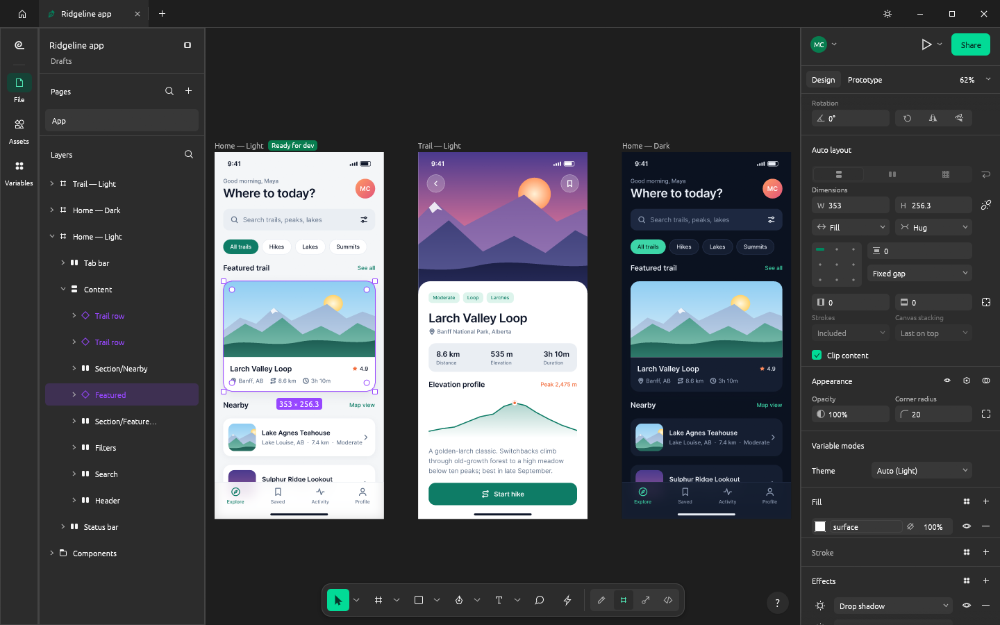

# FigCraft for Codex

Use Codex to create and edit designs in [FigCraft](https://getartcraft.com/apps/figcraft), the open-source interface design app from ArtCraft. The plugin includes five skills for documents, screen layouts, design systems, prototypes, and developer handoff. It also configures a local MCP connection for Codex Desktop and CLI.

[](https://getartcraft.com/apps/figcraft)

*FigCraft's Ridgeline demo. Screenshot from the [ArtCraft Press Kit](https://getartcraft.com/press-kit).*

## Install

1. Install the [FigCraft CLI](https://craft.wiki/apps/figcraft/ai-agents/#get-the-command-line-tool) for your platform. Make `figcraft-cli` available on the `PATH` inherited by Codex and confirm that `figcraft-cli --version` runs. The Windows executable is `figcraft-cli.exe`. For an AppImage or Flatpak, use the launcher from the FigCraft guide and [configure a different connection](#configure-a-different-connection) after installing the plugin.
2. Register the marketplace and install **FigCraft** in the Codex profile you use for Desktop or CLI.

   ```sh
   codex plugin marketplace add design4pro/figcraft-skills
   codex plugin add figcraft@figcraft-skills
   ```

3. Open a new Codex chat and try `$figcraft:figcraft-documents List the open FigCraft documents.` Check `/mcp` for `figcraft-headless` and its tools if the server is unavailable.

The bundled `figcraft-headless` server launches `figcraft-cli mcp` over stdio. It starts a separate headless editing session with an untitled document. The process runs with your user account's permissions. Give it absolute file paths because relative paths resolve against the server's working directory.

## Use the skills

| Skill | Example prompt |
| --- | --- |
| `figcraft-documents` | `$figcraft:figcraft-documents Open /absolute/path/checkout.figcraft and list the top-level frames.` |
| `figcraft-layout` | `$figcraft:figcraft-layout Create a mobile checkout screen with an auto-layout order summary and a fixed action area.` |
| `figcraft-design-system` | `$figcraft:figcraft-design-system Make a reusable button component with Primary and Secondary variants and bind its fill to a color variable.` |
| `figcraft-prototype` | `$figcraft:figcraft-prototype Add a Checkout flow and link the Place order button to the Confirmation frame.` |
| `figcraft-handoff` | `$figcraft:figcraft-handoff Inspect the Confirmation frame and export it to /absolute/path/out/confirmation.png.` |

## Configure a different connection

If Codex cannot find `figcraft-cli`, verify the binary from a terminal. The desktop app can inherit a different `PATH` from your shell. Restart it after updating the environment it inherits, or use a custom MCP entry with an absolute executable path. Use the custom entry for AppImage and Flatpak launch commands as well. See the [FigCraft CLI installation guide](https://craft.wiki/apps/figcraft/ai-agents/#get-the-command-line-tool) for the platform-specific command.

Keep the skills enabled and turn off the bundled server by adding this to the active Codex `config.toml`, usually `~/.codex/config.toml`.

```toml
[plugins."figcraft@figcraft-skills".mcp_servers.figcraft-headless]
enabled = false
```

Then choose a connection and open a new Codex chat. Name the custom server in your first prompt if more than one FigCraft connection is available.

### Headless with an absolute path or restricted file access

```sh
codex mcp add figcraft -- /absolute/path/to/figcraft-cli mcp \
  --automation-read-root /absolute/path/to/project \
  --automation-write-root /absolute/path/to/project/out
```

Both directories must already exist. The write root also allows reads. Setting only a read root allows inspection and in-memory exports while blocking disk writes. For an absolute executable path with normal process access, omit both root flags. If `figcraft` is already configured, reuse that connection and check its arguments with `codex mcp get figcraft`.

### Attach to the FigCraft window

Start FigCraft with a local control port, then register an attached server. Replace `figcraft` with the app executable's path as needed.

```sh
figcraft --control 7979
```

```sh
codex mcp add figcraft-desktop -- /absolute/path/to/figcraft-cli mcp --attach 7979
```

For file restrictions in this mode, pass the automation root flags to the FigCraft application when you start it. Use `figcraft-desktop` in the prompt to target the open window or test a prototype in the presenter.

See the [FigCraft MCP reference](https://github.com/storytold/figcraft/blob/v0.18.1/docs/mcp.md) and [Codex MCP settings](https://learn.chatgpt.com/docs/extend/mcp) for connection and tool details.
